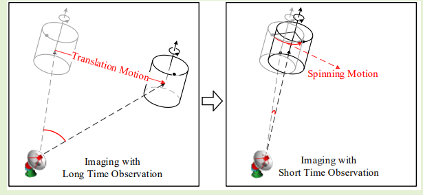
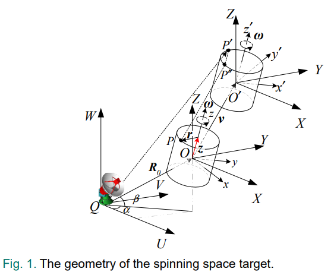
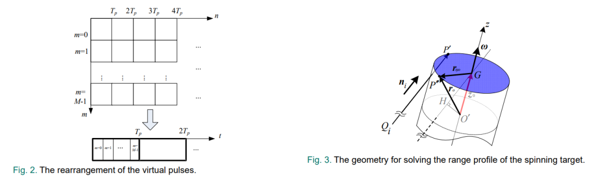
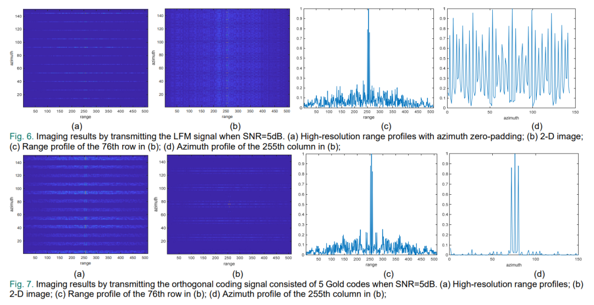
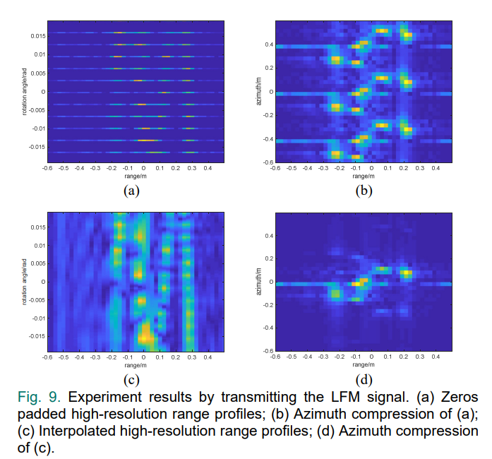
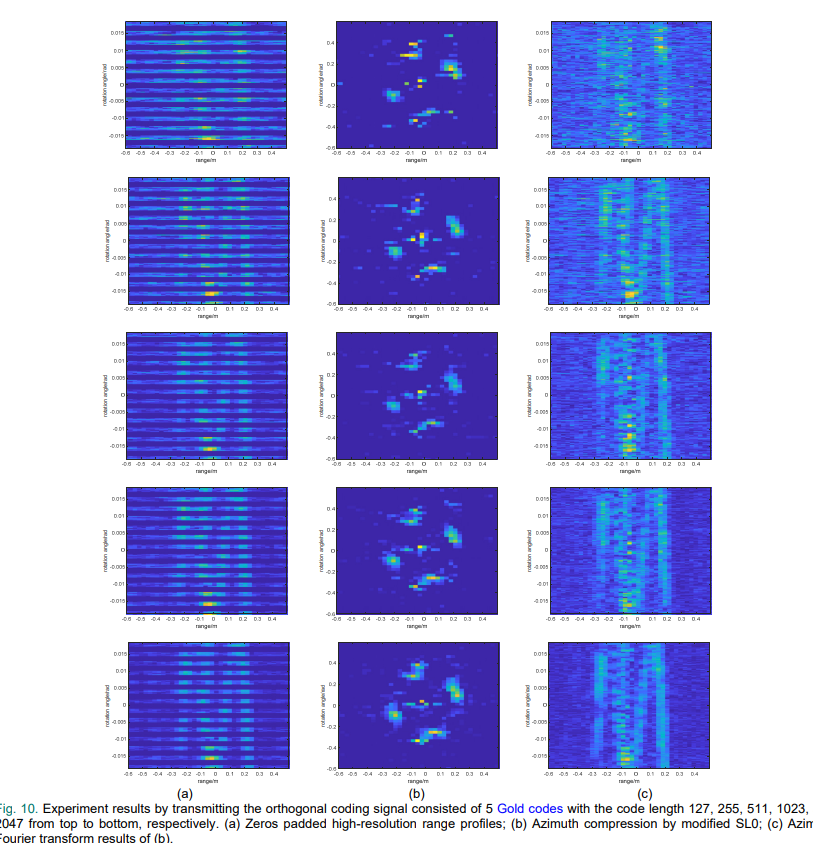

# Radar Imaging: Sparse Imaging Method for Short-Term Observation of Rotating Space Objects [with MATLAB Code]

Inverse Synthetic Aperture Radar (ISAR) imaging is an important technology for the recognition and classification of moving targets. For rotating space targets, traditional ISAR imaging methods require long-term observation to estimate rotation parameters. However, for advanced multi-functional radars used for multi-target surveillance, it is not cost-effective to observe a single target over an extended period. To reduce observation time, this paper proposes a novel imaging method for observing rotating space targets in a short time. Firstly, by utilizing the azimuth rotation angle caused by rotational motion instead of translational motion to construct the imaging model, we achieve azimuth resolution. Secondly, by using orthogonal encoding signals with different delays to obtain sufficient equivalent pulses within a short observation time. Additionally, since the equivalent pulses are block missing to avoid overlapping between the emission duration and reception duration, the imaging problem is transformed into a Compressed Sensing (CS) problem, which is solved through an improved smooth L0 norm (SL0) algorithm. Finally, both simulations and real data experiments have demonstrated the effectiveness of this method. Since this method only requires observation time covering a small portion of a rotation cycle, it can be applied to satellite and space debris surveillance.
In recent years, due to the development of space resource utilization, there has been a sharp increase in the number of space debris. Therefore, detection, identification, and classification of space debris have attracted more attention. Optical communication systems have many advantages, but optical remote sensing devices for space debris are easily affected by observation conditions. Inverse Synthetic Aperture Radar (ISAR) is widely used for acquiring images of space debris due to its advantages of all-weather, all-time, and long-distance. It obtains range resolution by transmitting wideband signals and azimuth resolution by the relative motion between the sensor and the target caused by the azimuth rotation angle. After precise translation compensation, the ISAR imaging geometry becomes a turntable model, which can generate focused radar images through classical imaging methods such as range-Doppler (RD) method.
However, for rotating space targets, rotational motion will cause additional time-varying periodic Doppler frequency modulation in the radar echoes, a micro Doppler phenomenon. In broadband radar imaging, the micro Doppler phenomenon is reflected in the m-D curve in the distance - slow time domain that represents the motion of distance cells (RCM). Typically, slow-varying RCM can be compensated for by using higher order phases to approximate the rotational motion-induced phase shifts. As the number of compensation phases and approximation errors increase with the rotational speed, this method is unacceptable for imaging fast-rotating targets. To address this issue, Hough transform and inverse Laplace transform are used to estimate rotation parameters, and empirical mode decomposition (EMD) is introduced to separate the micromotion components. Additionally, for rotating space targets, an approach based on the Instantaneous Radar Cross Section (RID) for rotation parameter estimation and 3D imaging is proposed. Since rotation parameter estimation is a core issue in the above imaging methods, multiple rotation cycles need to be observed. For single target surveillance, this requirement is acceptable. However, for multi-target surveillance, only observing one target over an extended period is not cost-effective. Therefore, imaging methods for short-duration observation of rotating space targets are needed.
The commonality of the above methods is that the azimuth resolution is determined by the azimuth rotation angle caused by target motion other than rotational motion. However, target rotational motion also creates an azimuth rotation angle between the scatterer and the radar. By achieving azimuth rotation angle through rotational motion rather than translational motion, there are two advantages. Firstly, since only a small portion of a single rotation cycle needs to be covered, the observation time will significantly decrease. Secondly, during short-duration observation, the RCM in the distance - slow time domain is very small.
This paper proposes a novel sparse imaging method for observing rotating space targets in a short observation time. By utilizing the azimuth rotation angle caused by target rotation to obtain azimuthal resolution. To achieve sufficient azimuthal sampling points within a short observation time, multiple Gold coded sequences with different delays are utilized to achieve high virtual pulse repetition frequency (PRF). Since the virtual pulse is designed to block blocks to avoid the overlap of emission and reception durations, azimuthal compression can be solved through an improved smooth L0 norm (SL0) algorithm. Finally, real data experiments show that this method only requires an observation time covering a small portion of one rotation cycle, and it avoids large RCM in the distance-slow time domain.
Figures in the article
Conclusion This paper proposes a novel sparse imaging method for observing rotating space targets in a short observation time. Compared to methods requiring multiple observation cycles, this method only requires an observation time covering a small portion of one rotation cycle. It can reduce the time resource for single rotation target radar imaging tasks. Moreover, more importantly, short observation imaging can be used for multi-target surveillance such as satellites and space debris. This method has potential applications in space resource utilization and space defense.
End

## Images

<!-- PAYMENT_BLOCK -->

## Get this dataset

- Payment link (Stripe): [Buy now](https://buy.stripe.com/3cs8yP7sY87d0vu9AB)
- Payment QR code: 

<!-- /PAYMENT_BLOCK -->
